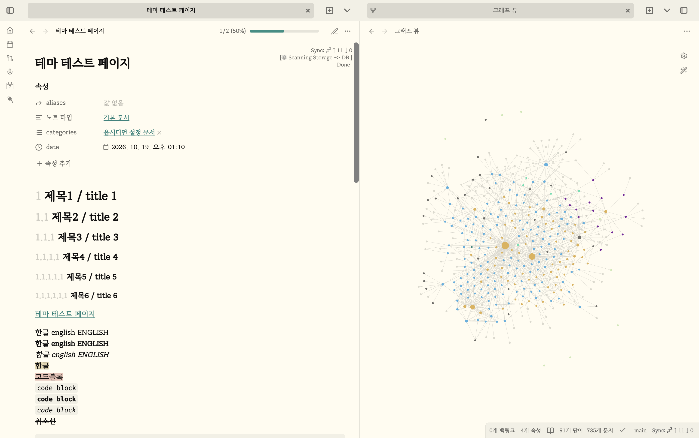
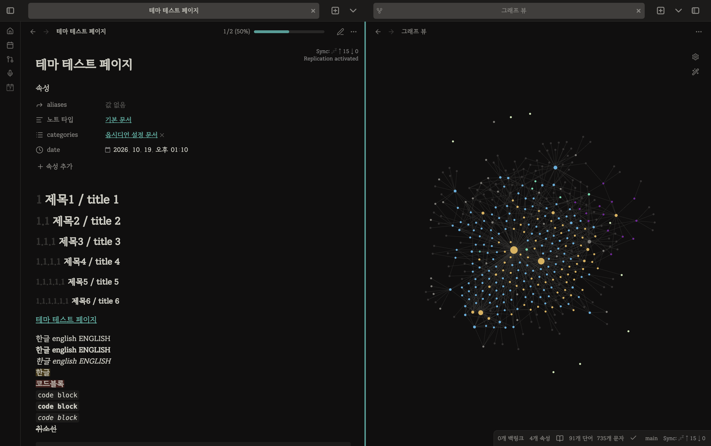

# Obsidian Adwaita Flexoki Theme

> 이 README 문서는 한국인을 위한 한국어 README 문서입니다. 영어 버전은 [여기](README.md)에 있습니다.
> this README is korean README, which is for korean users. English version README is [here](README.md).

이 테마는 [obsidian-adwaita-theme](https://github.com/birneee/obsidian-adwaita-theme)의 포크 기반으로 만들어졌으며, 해당 테마에 우리 시대의 진정한 영웅, 옵시디언의 CEO Kepano의 [flexoki](https://github.com/kepano/flexoki) 컬러 스킴을 적용하고, 한국어 유저에게 조금 더 나은 디자인을 제공하는 것을 목표로 하였습니다. 한국어 사용자를 위한 테마이지만, 영어 사용자도 아무 문제 없이 사용할 수 있는 테마입니다.

# 추가로 적용된 변경사항

## 테마

Kepano의 [flexoki](https://github.com/kepano/flexoki) 테마를 적용하였습니다.

다크 테마와 화이트 테마 모두 지원합니다.

|다크 모드|라이트 모드|
|:---:|:---:|
|||

## 폰트

더 좋은 가독성을 위해 [리디바탕체](https://ridicorp.com/ridibatang/)를 적용하였습니다. 한글 폰트 중 개인적으로 가장 마음에 드는 폰트이기 때문입니다.

한국어와 영어를 모두 지원하는 폰트입니다.

## 설치

### 커뮤니티 테마 스토어

1. `설정 → 테마 → 찾아보기`를 엽니다
2. `Adwaita Flexoki`를 검색합니다
3. `설치 및 사용`을 누릅니다

### 수동 설치

1. 볼트 안에 `.obsidian/themes/Adwaita Flexoki` 폴더를 만듭니다
2. [최신 릴리스](https://github.com/Chillbok/obsidian-adwaita-fleoki/releases/latest)에서 `theme.css`와 `manifest.json`을 내려받아 그 폴더에 넣습니다
3. `설정 → 테마`에서 `Adwaita Flexoki`를 선택합니다

## Style Settings

[Style Settings](https://github.com/mgmeyers/obsidian-style-settings) 플러그인을 설치하면 `설정 → 커뮤니티 플러그인 → Style Settings → Adwaita Flexoki`에서 세부 조정이 가능합니다.

| 항목 | 설명 |
|---|---|
| 창 버튼 | Linux 전용입니다. 배율, 오른쪽 여백, 각 버튼 숨김을 설정합니다 |
| 탭 → 짧은 탭 | 탭 폭을 좁힙니다. 기본값은 꺼짐입니다 |
| 폰트 | 내장 리디바탕(기본) 또는 시스템 폰트를 선택합니다 |

색상, 탭 스타일, 아이콘은 항상 적용되며 별도로 켤 필요가 없습니다.

# 라이선스 및 크레딧

이 테마는 다음 오픈소스·오픈 라이선스 자산을 기반으로 만들어졌습니다.

| 대상 | 라이선스 | 저작권 |
|---|---|---|
| 테마 코드 | MIT | © 2022 birneee ([원본](https://github.com/birneee/obsidian-adwaita-theme)), © 2026 Chillbok |
| [Flexoki](https://stephango.com/flexoki) 색상 | MIT | © 2023 Steph Ango |
| [리디바탕](https://ridicorp.com/ridibatang/) 폰트 | SIL OFL 1.1 | © 2019 RIDI & Sandoll |
| [Adwaita 아이콘](https://www.gnome.org) | CC BY-SA 3.0 | GNOME Project |

폰트 라이선스 전문은 [licenses/RIDIBatang-OFL.txt](licenses/RIDIBatang-OFL.txt)에 포함되어 있습니다.
이 테마는 리디주식회사에서 제공한 리디바탕 글꼴을 사용합니다.
